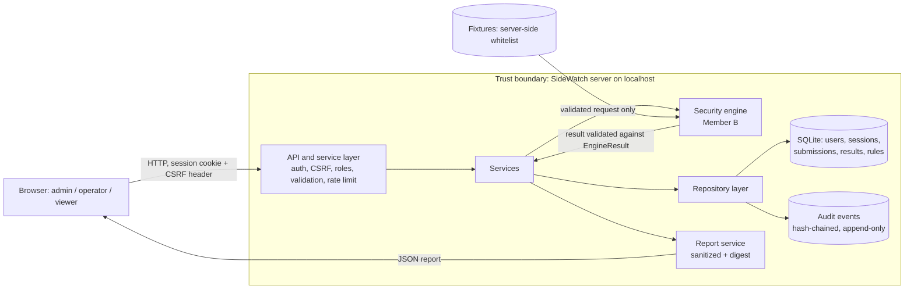

# 🛡️ SideWatch: Timing Leakage Measurement Lab

**(Side-Channel Detection and Mitigation)**

This is the shared project document. Each member adds their own part under their section.

| Part | Owner |
|---|---|
| Part 1: Backend, data and authentication | Member A |
| Part 2: Security engine and evaluation fixtures | Member B |
| Part 3: Frontend, reporting and integration | Member C |
| Part 4: Automation, security testing, packaging and QA | Member D |

---

# 🧱 Part 1: Backend, Data and Authentication (Member A)

## 🎯 1.1 Scope

Member A owns the foundation that the rest of the team builds on:

- Data model, roles, and the input, result and audit-event schemas
- FastAPI service layer: authentication, sessions, CSRF, authorization, rate limiting, safe errors
- Repository layer with parameterized queries and a tamper-evident, append-only audit log
- Endpoints for authentication, submission, result retrieval, administration and report export
- Startup safety checks, restart recovery, security headers and request-size limits
- Same-origin hosting of Member C's frontend

The engine is Member B's. The backend talks to it only through `engine/interface.py`.

## 🏗️ 1.2 Architecture

The layered design follows the proposal. Security logic lives in `core/`, `services/` and `repositories/`, never only in the browser.

```
backend/app/
  api/            route handlers: auth, users, audit, submissions, rules
  core/           security.py (hashing, tokens), deps.py (auth, CSRF, roles, rate limit),
                  errors.py, middleware.py, redact.py, rate_limit.py, startup.py, enums.py
  models/         tables.py (SQLAlchemy tables)
  schemas/        Pydantic input and output contracts
  repositories/   all database access: audit_repo, user_repo, submission_repo, rule_repo
  services/       business rules: auth, session, submission, report, recovery
  config.py  
  database.py  
  main.py
engine/           interface.py (contract with Member B)
frontend/         Member C's files, served from the same origin
scripts/          seed_admin.py (first administrator)
```

### 🔄 Request pipeline

1. `SecurityHeadersMiddleware` adds headers to every response, including errors.
2. `BodySizeLimitMiddleware` rejects bodies above `MAX_BODY_BYTES` (413) and chunked bodies with no length (411).
3. Rate-limit dependency (sensitive routes only).
4. `get_auth` checks the session cookie, the session's expiry and revocation, whether the user is active, and the CSRF header on POST, PUT, PATCH and DELETE.
5. `require_roles` enforces the role. A denial is written to the audit log.
6. Pydantic validates the body (`extra="forbid"`).
7. Service layer applies business rules and calls the engine.
8. Repository layer reads and writes the database through SQLAlchemy (parameterized).
9. An audit event is appended for every security-relevant action, including denials and failures.

## 🗺️ 1.3 Data-flow diagram and trust boundaries



| Boundary | What crosses it | Control |
|---|---|---|
| B1: Browser to API | All user input, cookies, CSRF token | Authentication, CSRF, server-side roles, strict schemas, size limit, rate limit, security headers |
| B2: Service to engine | Validated measurement request | Fixture whitelist, engine output validated by `EngineResult`, crashes become `ENGINE_FAILED` |
| B3: Application to database file | Records, hashed secrets | Parameterized queries, Argon2id, keyed token hashes, append-only triggers, HMAC chain |
| B4: Server to report reader | Exported report | Redaction, no user ids or IPs, SHA-256 digest also stored in the audit log |

## 👥 1.4 Roles and permissions

All checks happen on the server.

| Action | admin | operator | viewer |
|---|---|---|---|
| Create users, deactivate users, reset passwords | ✅ Yes | ❌ No | ❌ No |
| Change rules and thresholds (with confirmation) | ✅ Yes | ❌ No | ❌ No |
| Read and verify the audit log | ✅ Yes | ❌ No | ❌ No |
| List rules | ✅ Yes | ✅ Yes | ❌ No |
| Submit and run a measurement | ✅ Yes | ✅ Yes | ❌ No |
| See submissions | All | Own only | Completed only |
| View results and export reports | All | Own only | Completed only |
| Change own password | ✅ Yes | ✅ Yes | ✅ Yes |

A user asking for a submission they cannot see receives the same 404 as for one that does not exist. The attempt is logged without revealing the record.


## 🔌 1.5 API reference

Base path `/api`. Interactive documentation is at `/api/docs`. "CSRF" means the `X-CSRF-Token` header is required.

| Method and path | Who | CSRF | Limit | Purpose |
|---|---|---|---|---|
| GET `/health` | public | no | | Liveness check |
| POST `/auth/login` | public | no | 10/min per IP | Sign in, sets HttpOnly cookie, returns user and CSRF token |
| POST `/auth/logout` | any signed-in | 🔑 yes | | Revoke the session |
| GET `/auth/me` | any signed-in | no | | Current user |
| GET `/auth/csrf` | any signed-in | no | | New CSRF token (invalidates the previous one) |
| POST `/auth/change-password` | any signed-in | 🔑 yes | 5/min per IP | Change own password, revokes all sessions, issues a fresh one |
| GET `/users` | admin | no | | List users |
| POST `/users` | admin | 🔑 yes | | Create user |
| PATCH `/users/{id}/active` | admin | 🔑 yes | | Activate or deactivate (revokes sessions); not on self |
| POST `/users/{id}/reset-password` | admin | 🔑 yes | | Reset password, `confirm: true` required; revokes sessions, clears lockout; not on self |
| GET `/audit` | admin | no | | Filter by `action`, `outcome`, `actor_id`; paged |
| GET `/audit/verify` | admin | no | | Verify the hash chain |
| GET `/fixtures` | any signed-in | no | | List whitelisted fixtures |
| POST `/submissions` | admin, operator | 🔑 yes | 20/min per IP | Create and run a measurement |
| GET `/submissions` | any signed-in | no | | History; filters `status`, `implementation`; role-scoped |
| GET `/submissions/{id}` | role-scoped | no | | One submission |
| GET `/submissions/{id}/result` | role-scoped | no | | Explainable result |
| GET `/submissions/{id}/report` | role-scoped | no | 10/min per IP | Sanitized JSON report with integrity digest |
| GET `/rules` | admin, operator | no | | Current thresholds |
| PUT `/rules/{key}` | admin | 🔑 yes | | Change a threshold, `confirm: true` required |


## ⚠️ 1.6 Threat model (backend portion)

| # | Threat | Where | Mitigation | Evidence (test file) |
|---|---|---|---|---|
| T01 | Password guessing and credential stuffing | Login | Argon2id, lockout after 5 failures, 10/min rate limit, identical errors | `test_api.py` |
| T02 | Username enumeration | Login | Same error and code for unknown user, wrong password and deactivated user; dummy hash for timing | `test_api.py` |
| T03 | Stolen session or database copy | Sessions | Only keyed hashes stored, HttpOnly cookie, expiry, revocation on key events | `test_sessions.py`, `test_accounts_api.py` |
| T04 | Cross-site request forgery | State-changing routes | Per-session CSRF header, SameSite=Strict cookie | `test_api.py`, `test_submissions_api.py` |
| T05 | Privilege escalation or broken authorization | All routes | Server-side `require_roles`, ownership scoping, denials audited | `test_api.py`, `test_submissions_api.py`, `test_rules_api.py` |
| T06 | Insecure direct object reference | Submissions, results, reports | Not-yours and missing both return 404; attempt audited | `test_submissions_api.py`, `test_report_api.py` |
| T07 | SQL injection | Repositories | SQLAlchemy parameterization, strict schemas, id and fixture patterns | `test_schemas.py`, `test_submissions_api.py` |
| T08 | Audit log tampering or deletion | Audit table | Database triggers block UPDATE and DELETE; HMAC chain detects edits made by bypassing triggers | `test_audit.py`, `test_recovery.py` |
| T09 | Sensitive data in logs or errors | Logging, error handler | Redaction, generic errors, no input echo, passwords never logged | `test_redact.py`, `test_errors.py`, `test_accounts_api.py` |
| T10 | Oversized or malformed input, resource exhaustion | Request layer | 64 KB limit, 411 for undeclared length, schema bounds, rate limits | `test_middleware.py`, `test_tfinal_backend.py` |
| T11 | Unsafe or malicious engine behavior | Service to engine | Fixture whitelist, one measurement at a time, output validated, failures become `ENGINE_FAILED` | `test_submissions_api.py` |
| T12 | Weak deployment secret | Configuration | Production refuses placeholder or short key; `.env` git-ignored | `test_startup.py` |
| T13 | Interrupted run leaves false state after a crash | Startup | Recovery marks runs failed and audits each one; chain verified at start | `test_recovery.py` |
| T14 | Tampering with an exported report | Report | SHA-256 digest inside the report and in the audit log | `test_report_api.py` |
| T15 | Clickjacking and content sniffing | Responses | `X-Frame-Options`, CSP `frame-ancestors`, `nosniff` | `test_middleware.py`, `test_frontend.py` |

## 🤝 1.7 Interface contracts for teammates

### 🔬 For Member B (engine)

- Replace the body of `run_analysis(req: EngineRequest)` in `engine/interface.py`. Keep the signature and the returned keys.
- Return a dict that validates against `EngineResult` in `backend/app/schemas/result.py`: `decision`, `severity`, `confidence` (0 to 1), `p_value`, `effect_size`, `ci_low`, `ci_high`, `evidence`, `reasons` (at least one), `rule_name`, `rule_version`, `engine_version`, `thresholds`.
- Extend the `FIXTURES` whitelist. Anything not on it is rejected before the engine runs.
- Thresholds arrive in `req.thresholds` from the database. The backend stores that snapshot with the result.
- Measurements are serialized by a lock, so only one run executes at a time.
- Anything that crashes or returns invalid output is shown to the user only as `ENGINE_FAILED`. The traceback goes to the server log.

### 🖥️ For Member C (frontend)

- Put files in `frontend/` with `index.html` as the entry point.
- Use relative URLs such as `fetch("/api/...")`. Same origin means no CORS.
- Keep the CSRF token in memory only. On page load call `GET /api/auth/me`, and if it succeeds call `GET /api/auth/csrf`. Send the token as `X-CSRF-Token` on every POST, PUT, PATCH and DELETE.
- The page CSP allows only files served from `frontend/`: no inline `<script>` or `<style>`, no inline event handlers, no CDN links. Download chart libraries into `frontend/`.
- Handle the error codes in section 1.7. A 401 means show the login screen.
- For high-impact actions (rule changes, password resets) show a confirmation dialog and send `confirm: true`.

## ⚙️ 1.8 Setup guide

📦 Requirements: Python 3.12 or newer (developed on 3.14), or Docker Desktop with Docker Compose.

### Run with Docker

From the project root, copy `.env.example` to `.env` and set `SECRET_KEY` to a random value of at least 32 characters (for example, generate one with `python -c "import secrets; print(secrets.token_urlsafe(48))"`). Then start the app:

```
docker compose up --build
```

Open `http://127.0.0.1:8000/` for the interface and `http://127.0.0.1:8000/api/docs` for the API documentation. The SQLite database is stored in the `sidewatch-data` Docker volume. Stop the app with `Ctrl+C`; use `docker compose down` to remove its container while keeping the database volume.

The Compose setup is for local development only. It binds the app to localhost and must not be used as a production deployment.

### Run directly with Python

```
python -m venv .venv
.venv\Scripts\Activate.ps1          # Windows PowerShell
source .venv/bin/activate           # macOS or Linux
pip install -r requirements.txt
```

Create `.env` in the project root (it is git-ignored):

```
APP_ENV=development
DATABASE_URL=sqlite:///./data/sidewatch.db
SESSION_TTL_MINUTES=30
SECRET_KEY=<paste output of the command below>
MAX_BODY_BYTES=65536
```

```
python -c "import secrets; print(secrets.token_urlsafe(48))"
```

Create the first administrator (the password is typed at a hidden prompt), then start the server:

```
python -m scripts.seed_admin --username admin
uvicorn backend.app.main:app --reload
```

Open `http://127.0.0.1:8000/` for the interface and `http://127.0.0.1:8000/api/docs` for the API documentation. Run the tests with `pytest`.

🚨 Important: never change `SECRET_KEY` on a database that already has data. All sessions stop working and the audit chain fails verification. In development, delete `data/sidewatch.db` and seed again.

## 🧑‍💼 1.9 Administrator guide

| Task | How |
|---|---|
| Create the first admin | `python -m scripts.seed_admin --username admin` |
| Add a user | `POST /api/users` with username, password and role |
| Deactivate a user | `PATCH /api/users/{id}/active` with `{"is_active": false}`. Their sessions end immediately |
| Reset a forgotten password | `POST /api/users/{id}/reset-password` with `{"new_password": "...", "confirm": true}`. Also clears a lockout |
| Change a threshold | `PUT /api/rules/{key}` with `{"value": ..., "confirm": true}`. The change is audited and every later result stores the thresholds it used |
| Review activity | `GET /api/audit` with filters, for example `?action=auth.login&outcome=failure` |
| Verify audit integrity | `GET /api/audit/verify` should return `"intact": true` |
| Export a report | `GET /api/submissions/{id}/report` |

## ✅ 1.10 Test evidence (Member A portion)

✅ 127 automated tests, all passing.

| File | Tests | Covers |
|---|---|---|
| `test_health.py` | 1 | Liveness |
| `test_models.py` | 3 | Server-generated ids, unique usernames, submission/result link |
| `test_schemas.py` | 5 | Range limits, unknown fields, label and password rules |
| `test_security.py` | 8 | Argon2id, tokens, constant-time compare |
| `test_sessions.py` | 7 | Creation, expiry, revocation, CSRF, no raw tokens stored |
| `test_errors.py` | 4 | Safe errors, no input echo, no stack traces |
| `test_redact.py` | 3 | Sensitive key masking and truncation |
| `test_audit.py` | 8 | Chain, triggers, tamper detection, redaction, filters |
| `test_user_repo.py` | 6 | Hashing, case-insensitive names, lockout |
| `test_submission_repo.py` | 5 | Defaults, scoping, status, result save |
| `test_rule_repo.py` | 4 | Defaults, bounds, versioning, unknown keys |
| `test_api.py` | 13 | Login, enumeration, lockout, CSRF, roles, audit, rate limit |
| `test_submissions_api.py` | 11 | Workflow, whitelist, role scoping, filters, engine failure |
| `test_rules_api.py` | 5 | Admin change, confirmation, bounds, traceability |
| `test_report_api.py` | 8 | Sanitized export, digest, audit, access control |
| `test_middleware.py` | 5 | Headers, 413, 411 |
| `test_recovery.py` | 4 | Interrupted runs, broken chain report, restart survival |
| `test_tfinal_backend.py` | 4 | Malformed input, unauthorized request, repeats, rate limit |
| `test_accounts_api.py` | 13 | Password change and reset, CSRF refresh |
| `test_startup.py` | 6 | Production key guard, session purge |
| `test_frontend.py` | 4 | Frontend served, page CSP, project files not exposed |

---

# 🔬 Part 2: Security Engine and Evaluation Fixtures (Member B)

## 🎯 2.1 Scope

Member B owns the security engine, the part of SideWatch that actually measures timing leakage:

- A deliberately **vulnerable** early-exit comparison and a **constant-time** comparison
- A repeated-measurement harness with warm-up, randomized pair order, and optional controlled jitter
- Statistical comparison with SciPy: paired t-test, effect size, and a confidence interval
- A rule-based decision (leak, no leak, or inconclusive) with a severity and an explanation
- Mitigation recommendations attached to every decision
- Safe, fixed-width fixtures and the evaluation harness for the proposal's cases T1 to T6

The engine is plain Python with no web dependency. It is reached only through the contract in `engine/interface.py`.

| File | Purpose |
|---|---|
| `engine/interface.py` | Contract with the backend: `EngineRequest`, `list_fixtures()`, `run_analysis()`, input validation, measurement, statistics and decision rules |
| `engine/fixtures.py` | Whitelisted fixtures and the fixed public reference value |
| `engine/evaluation.py` | T1 to T6 demonstration that prints a JSON evidence report |
| `backend/tests/test_engine.py` | 13 automated engine tests |

## 🔬 2.2 Engine workflow

The engine compares a selected, fixed-width demo candidate with the `no_match` control. The `vulnerable` implementation exits at the first differing byte. The `constant_time` implementation uses Python's `hmac.compare_digest`. These are local, instructor-safe examples only: no user password, network target, or production credential is used.

1. **Validate.** The request is checked before anything runs (see section 2.5).
2. **Warm up.** Both the control and the fixture are compared `warmup_runs` times, untimed, so caches and the interpreter settle.
3. **Schedule.** A seeded random generator decides, for each pair, whether the fixture or the control is timed first. The schedule is hashed (SHA-256) so a run can be reproduced and checked.
4. **Measure.** For each of the `sample_size` pairs, each side is timed over a batch of 64 comparisons with `perf_counter_ns`, and the per-call mean in nanoseconds is stored. For jitter fixtures, a seeded Gaussian overlay is added to each sample (values below zero are clamped and counted).
5. **Compare.** SciPy runs a two-sided paired t-test on the fixture-minus-control differences. The engine computes the mean difference, paired Cohen's dz, and a t-based confidence interval at the configured `ci_level`.
6. **Decide.** The decision rules in section 2.3 produce a decision, a severity and a list of reasons.
7. **Return.** A dictionary that validates against `EngineResult` is returned. The backend stores it with the threshold snapshot and the rule and engine versions.

The `confidence` field is the configured confidence-interval level, not a posterior probability. The result says so in `evidence.confidence_interpretation`.

## ⚖️ 2.3 Decision rules

Rule name `paired_timing_leakage`, rule version `1`, engine version `1.0.0`. Thresholds come from the database (Part 1, rule configuration) and are copied into every result.

| Threshold | Default | Permitted range | Meaning |
|---|---|---|---|
| `alpha` | 0.01 | 0.0001 to 0.1 | Significance level for the paired t-test |
| `min_effect_size` | 0.2 | 0 to 5 | Smallest absolute Cohen's dz treated as meaningful |
| `ci_level` | 0.99 | 0.8 to 0.999 | Confidence level of the interval on the mean difference |

These are the same defaults and bounds as the backend's `rule_repo`, so the two sides agree.

| Decision | Condition |
|---|---|
| `leak_detected` | p-value below `alpha`, **and** the interval excludes zero, **and** the absolute effect size is at least `min_effect_size` |
| `no_leak_detected` | p-value at or above `alpha`, **and** the interval contains zero, **and** the absolute effect size is at most `min_effect_size` |
| `inconclusive` | Everything else, for example significant but a tiny effect, or noisy data |

| Severity | When |
|---|---|
| `high` | Leak with absolute effect size of 0.8 or more |
| `medium` | Leak with absolute effect size of 0.5 to under 0.8 |
| `low` | Leak with a smaller effect size, or any inconclusive result |
| `info` | No leak detected |

Severity measures how large the timing difference is relative to its noise. It is not a measure of how exploitable the leak is in a real system.

Edge case: if every paired difference is identical (zero spread), the engine reports effect size 0 and p = 1 when the difference is zero, or a capped effect size of ±1000 and p = 0 otherwise, instead of dividing by zero.

## 🧪 2.4 Fixtures

All fixtures are 32 bytes long and compare against one fixed, public reference value (`bytes(range(32))`). It is a demo value, not a secret.

| Fixture | Meaning |
|---|---|
| `no_match` | Control; differs at the first byte |
| `prefix_1` | Matches one leading byte |
| `prefix_4` | Matches four leading bytes |
| `full_match` | Matches all 32 bytes |
| `prefix_1_jitter` | One-byte prefix with a 250 ns standard-deviation Gaussian measurement overlay |
| `prefix_4_jitter` | Four-byte prefix with the same controlled jitter |

The backend exposes this list through `GET /api/fixtures`, and anything not on it is rejected before the engine runs.

## 🤝 2.5 Contract with the backend

- `run_analysis(req: EngineRequest)` returns a dictionary validated by `EngineResult`: `decision`, `severity`, `confidence`, `p_value`, `effect_size`, `ci_low`, `ci_high`, `evidence`, `reasons` (at least one), `rule_name`, `rule_version`, `engine_version`, `thresholds`.
- The engine **validates its own input as well**, so it stays safe if called from somewhere else:

| Field | Rule |
|---|---|
| `implementation` | `vulnerable` or `constant_time` |
| `fixture_id` | Must be on the whitelist |
| `sample_size` | Integer from 30 to 5000 (booleans rejected) |
| `warmup_runs` | Integer from 0 to 500 |
| `seed` | `None`, or an integer from 0 to 2147483647 |
| `thresholds` | Exactly `alpha`, `min_effect_size` and `ci_level`, each finite and within its range |

- Invalid input raises `ValueError`. The backend turns any engine exception into the generic `ENGINE_FAILED` code and keeps the traceback in the server log (see Part 1).
- The backend runs one measurement at a time, so concurrent requests cannot disturb each other's timings.

## 📊 2.6 Result and evidence fields

These fields are what Member C's dashboard and charts read from `GET /api/submissions/{id}/result`.

| Field | Content |
|---|---|
| `p_value`, `effect_size`, `ci_low`, `ci_high` | Paired t-test p-value, Cohen's dz, and the interval on the mean difference in ns |
| `evidence.mean_difference_ns` | Mean fixture-minus-control difference |
| `evidence.comparison` | For example `prefix_4 versus no_match` |
| `evidence.implementation`, `fixture_description` | What was measured |
| `evidence.sample_size_per_group`, `warmup_runs_per_group`, `timed_calls_per_sample` | Measurement settings |
| `evidence.histogram` | `bin_edges_ns` (21 edges), `baseline_counts`, `fixture_counts` (20 bins each, shared bins, ready to chart) |
| `evidence.baseline_summary_ns`, `fixture_summary_ns` | Mean, median and standard deviation of each group |
| `evidence.paired_difference_summary_ns` | Mean and standard deviation of the paired differences |
| `evidence.jitter` | Whether jitter was injected, its model and standard deviation, how many samples were clamped, and a digest of the jitter sequence |
| `evidence.seed`, `schedule_sha256` | Reproducibility metadata |
| `evidence.confidence_interpretation` | States that `confidence` is a CI level, not a posterior probability |

Histograms hold counts, not raw timing traces, which keeps stored evidence small and avoids retaining unnecessary data.

## 🛠️ 2.7 Mitigation recommendations (FR-6)

Every result carries a plain-language explanation in `reasons`, chosen by the decision:

| Decision | What the reasons say |
|---|---|
| `leak_detected` | Reports how many ns slower or faster the fixture was than the control, with the p-value and effect size, and recommends a fixed-length constant-time comparison such as `hmac.compare_digest` and not revealing comparison progress through responses |
| `no_leak_detected` | States that no significant difference above the effect-size threshold was found, that this does not prove the implementation is constant-time, and recommends continuing to use a constant-time comparison |
| `inconclusive` | Recommends collecting more samples or reducing jitter, and using a constant-time comparison while the result is unresolved |

The recommendation is chosen per decision, not per individual finding. The backend stores it with the result and includes it in the exported report.

## ⚠️ 2.8 Threat model (engine portion)

| # | Threat | Mitigation | Evidence |
|---|---|---|---|
| E01 | Untrusted or malformed input reaching the measurement code | Engine-side validation of every field, fixture whitelist, finite and bounded thresholds | `test_invalid_engine_requests_are_rejected` |
| E02 | Engine used to probe real systems | Fixtures are local byte strings compared in-process; the engine performs no network or file access and users cannot supply a target | `test_fixtures_are_fixed_width_and_prefix_controlled` |
| E03 | False alarms or missed leaks caused by timing noise | Paired design, randomized order within each pair, warm-up, batches of 64 calls, and three conditions (significance, interval, effect size) before a leak is called; an explicit `inconclusive` outcome | `test_statistical_decision_uses_significance_effect_and_interval` |
| E04 | Misreading `confidence` as a probability | Documented as the CI level and stated in every result's evidence | `test_analysis_returns_schema_valid_chart_ready_measurements` |
| E05 | Results that cannot be reproduced or audited | Seed, schedule digest, jitter digest, threshold snapshot, rule and engine versions stored with each result | `test_seed_reproduces_measurement_schedule_and_jitter` |
| E06 | Resource exhaustion through huge runs | Sample size capped at 5000, warm-up at 500, fixed 64 calls per sample; the backend adds a lock and rate limits | `test_invalid_engine_requests_are_rejected` |
| E07 | Numeric edge cases (NaN, infinity, zero variance, booleans passed as integers) | Finite checks, strict integer type checks, defined behavior for zero variance | `test_invalid_engine_requests_are_rejected`, `test_statistical_decision_uses_significance_effect_and_interval` |
| E08 | Overclaiming safety from a "no leak" result | Reasons state that the result is not proof of constant-time behavior | `test_member_b_evaluation_reports_all_proposal_cases` |
| E09 | Malformed engine output corrupting stored records | Output validated by `EngineResult` in the backend, failures become `ENGINE_FAILED` | `test_submissions_api.py` (Part 1) |

## ✅ 2.9 Evaluation cases T1 to T6

Run the demonstration from the project root:

```
python -m engine.evaluation
```

It prints a JSON report in which each case has its inputs, expected behavior, actual output, evidence and pass/fail status. The built-in checks verify engine behavior and fixture wiring. Timing values and statistical decisions are observations, not fixed expected answers.

| Case | What the harness checks | Engine evidence |
|---|---|---|
| T1: Sample-size sensitivity | Runs of 30 and 300 samples report their requested counts and complete histograms | Configurable samples per group; the interval width is returned |
| T2: Jitter | The jitter fixture reports enabled jitter, a 250 ns standard deviation and a 64-character sequence digest | Paired jitter fixtures and explicit jitter metadata |
| T3: Prefix guesses | `no_match`, `prefix_1`, `prefix_4` and `full_match` report their documented prefix lengths | Four fixtures with controlled prefix length |
| T4: Constant-time comparison | Both implementations run the same fixture and report their own identity | Same fixtures run against `hmac.compare_digest` |
| T5: Confidence intervals | `confidence` equals the configured `ci_level` and the bounds are finite and ordered | Paired t interval in ns at the configured `ci_level` |
| T6: Reproducibility | Two seeded runs produce identical schedule and jitter digests | Schedule SHA-256 and deterministic jitter stream |

## 🧾 2.10 Test evidence (Member B portion)

13 automated tests in `backend/tests/test_engine.py`, all passing. Together with Part 1, the full suite is 140 passing tests.

| Test | Covers |
|---|---|
| `test_fixtures_are_fixed_width_and_prefix_controlled` | All fixtures are 32 bytes with the documented prefix and mismatch positions |
| `test_analysis_returns_schema_valid_chart_ready_measurements` | Output validates against `EngineResult`; histogram has 21 edges and counts equal the sample size |
| `test_seed_reproduces_measurement_schedule_and_jitter` | Same seed gives the same schedule and jitter digests |
| `test_constant_time_mode_runs_through_same_contract` | Constant-time mode returns a valid result |
| `test_invalid_engine_requests_are_rejected` (7 cases) | Unknown implementation or fixture, sample size too small or a boolean, warm-up too large, negative seed, NaN threshold |
| `test_statistical_decision_uses_significance_effect_and_interval` | Leak, no-leak and inconclusive branches on constructed data |
| `test_member_b_evaluation_reports_all_proposal_cases` | T1 to T6 all present with inputs, expected, actual, evidence and a passing status |

---

# 🖥️ Part 3: Frontend, Reporting and Integration (Member C)


---

# 🧪 Part 4: Automation, Security Testing, Packaging and QA (Member D)