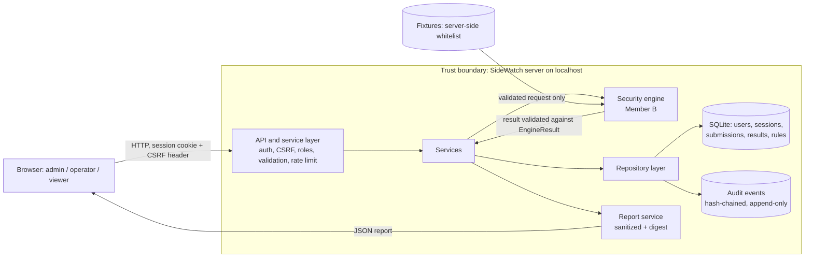

# 🛡️ SideWatch: Timing Leakage Measurement Lab

**(Side-Channel Detection and Mitigation)**

This is the shared project document. Each member adds their own part under their section.

| Part | Owner |
|---|---|
| Part 1: Backend, data and authentication | Member A |
| Part 2: Security engine and evaluation fixtures | Member B |
| Part 3: Frontend, reporting and integration | Member C |
| Part 4: Automation, security testing, packaging and QA | Member D |

---

# 🧱 Part 1: Backend, Data and Authentication (Member A)

## 🎯 1.1 Scope

Member A owns the foundation that the rest of the team builds on:

- Data model, roles, and the input, result and audit-event schemas
- FastAPI service layer: authentication, sessions, CSRF, authorization, rate limiting, safe errors
- Repository layer with parameterized queries and a tamper-evident, append-only audit log
- Endpoints for authentication, submission, result retrieval, administration and report export
- Startup safety checks, restart recovery, security headers and request-size limits
- Same-origin hosting of Member C's frontend

The engine is Member B's. The backend talks to it only through `engine/interface.py`.

## 🏗️ 1.2 Architecture

The layered design follows the proposal. Security logic lives in `core/`, `services/` and `repositories/`, never only in the browser.

```
backend/app/
  api/            route handlers: auth, users, audit, submissions, rules
  core/           security.py (hashing, tokens), deps.py (auth, CSRF, roles, rate limit),
                  errors.py, middleware.py, redact.py, rate_limit.py, startup.py, enums.py
  models/         tables.py (SQLAlchemy tables)
  schemas/        Pydantic input and output contracts
  repositories/   all database access: audit_repo, user_repo, submission_repo, rule_repo
  services/       business rules: auth, session, submission, report, recovery
  config.py  
  database.py  
  main.py
engine/           interface.py (contract with Member B)
frontend/         Member C's files, served from the same origin
scripts/          seed_admin.py (first administrator)
```

### 🔄 Request pipeline

1. `SecurityHeadersMiddleware` adds headers to every response, including errors.
2. `BodySizeLimitMiddleware` rejects bodies above `MAX_BODY_BYTES` (413) and chunked bodies with no length (411).
3. Rate-limit dependency (sensitive routes only).
4. `get_auth` checks the session cookie, the session's expiry and revocation, whether the user is active, and the CSRF header on POST, PUT, PATCH and DELETE.
5. `require_roles` enforces the role. A denial is written to the audit log.
6. Pydantic validates the body (`extra="forbid"`).
7. Service layer applies business rules and calls the engine.
8. Repository layer reads and writes the database through SQLAlchemy (parameterized).
9. An audit event is appended for every security-relevant action, including denials and failures.

## 🗺️ 1.3 Data-flow diagram and trust boundaries



| Boundary | What crosses it | Control |
|---|---|---|
| B1: Browser to API | All user input, cookies, CSRF token | Authentication, CSRF, server-side roles, strict schemas, size limit, rate limit, security headers |
| B2: Service to engine | Validated measurement request | Fixture whitelist, engine output validated by `EngineResult`, crashes become `ENGINE_FAILED` |
| B3: Application to database file | Records, hashed secrets | Parameterized queries, Argon2id, keyed token hashes, append-only triggers, HMAC chain |
| B4: Server to report reader | Exported report | Redaction, no user ids or IPs, SHA-256 digest also stored in the audit log |

## 👥 1.4 Roles and permissions

All checks happen on the server.

| Action | admin | operator | viewer |
|---|---|---|---|
| Create users, deactivate users, reset passwords | ✅ Yes | ❌ No | ❌ No |
| Change rules and thresholds (with confirmation) | ✅ Yes | ❌ No | ❌ No |
| Read and verify the audit log | ✅ Yes | ❌ No | ❌ No |
| List rules | ✅ Yes | ✅ Yes | ❌ No |
| Submit and run a measurement | ✅ Yes | ✅ Yes | ❌ No |
| See submissions | All | Own only | Completed only |
| View results and export reports | All | Own only | Completed only |
| Change own password | ✅ Yes | ✅ Yes | ✅ Yes |

A user asking for a submission they cannot see receives the same 404 as for one that does not exist. The attempt is logged without revealing the record.


## 🔌 1.5 API reference

Base path `/api`. Interactive documentation is at `/api/docs`. "CSRF" means the `X-CSRF-Token` header is required.

| Method and path | Who | CSRF | Limit | Purpose |
|---|---|---|---|---|
| GET `/health` | public | no | | Liveness check |
| POST `/auth/login` | public | no | 10/min per IP | Sign in, sets HttpOnly cookie, returns user and CSRF token |
| POST `/auth/logout` | any signed-in | 🔑 yes | | Revoke the session |
| GET `/auth/me` | any signed-in | no | | Current user |
| GET `/auth/csrf` | any signed-in | no | | New CSRF token (invalidates the previous one) |
| POST `/auth/change-password` | any signed-in | 🔑 yes | 5/min per IP | Change own password, revokes all sessions, issues a fresh one |
| GET `/users` | admin | no | | List users |
| POST `/users` | admin | 🔑 yes | | Create user |
| PATCH `/users/{id}/active` | admin | 🔑 yes | | Activate or deactivate (revokes sessions); not on self |
| POST `/users/{id}/reset-password` | admin | 🔑 yes | | Reset password, `confirm: true` required; revokes sessions, clears lockout; not on self |
| GET `/audit` | admin | no | | Filter by `action`, `outcome`, `actor_id`; paged |
| GET `/audit/verify` | admin | no | | Verify the hash chain |
| GET `/fixtures` | any signed-in | no | | List whitelisted fixtures |
| POST `/submissions` | admin, operator | 🔑 yes | 20/min per IP | Create and run a measurement |
| GET `/submissions` | any signed-in | no | | History; filters `status`, `implementation`; role-scoped |
| GET `/submissions/{id}` | role-scoped | no | | One submission |
| GET `/submissions/{id}/result` | role-scoped | no | | Explainable result |
| GET `/submissions/{id}/report` | role-scoped | no | 10/min per IP | Sanitized JSON report with integrity digest |
| GET `/rules` | admin, operator | no | | Current thresholds |
| PUT `/rules/{key}` | admin | 🔑 yes | | Change a threshold, `confirm: true` required |

### 🚨 Stable error codes

Every error has the shape `{"code", "message", "request_id"}`. Messages are generic. Stack traces go only to the server log.

| Code | HTTP | Meaning |
|---|---|---|
| `AUTH_INVALID_CREDENTIALS` | 401 | Wrong username or password (identical for unknown users and deactivated accounts) |
| `AUTH_ACCOUNT_LOCKED` | 423 | Too many failed logins; 15-minute lock after 5 failures |
| `AUTH_REQUIRED` | 401 | No session |
| `AUTH_SESSION_EXPIRED` | 401 | Session expired or revoked |
| `CSRF_FAILED` | 403 | Missing or wrong CSRF token |
| `ACCESS_DENIED` | 403 | Role not permitted |
| `NOT_FOUND` | 404 | Missing, or not visible to this user |
| `VALIDATION_ERROR` | 422 | Invalid body; never echoes the input |
| `INVALID_FIXTURE` | 422 | Fixture not on the whitelist |
| `INVALID_RULE_VALUE` | 422 | Threshold outside its permitted range |
| `PASSWORD_REUSE` | 422 | New password equals the current one |
| `CURRENT_PASSWORD_INVALID` | 400 | Wrong current password |
| `CONFIRMATION_REQUIRED` | 400 | High-impact action without `confirm: true` |
| `INVALID_OPERATION` | 400 | For example, an admin acting on their own account |
| `USER_EXISTS` | 409 | Username unavailable |
| `RATE_LIMITED` | 429 | Too many requests |
| `REQUEST_TOO_LARGE` | 413 | Body above the limit |
| `LENGTH_REQUIRED` | 411 | Chunked body with no declared length |
| `INTERNAL_ERROR` | 500 | Unexpected failure |

Submission `error_code` values: `ENGINE_FAILED` (engine crashed or returned invalid output), `INTERRUPTED_BY_RESTART` (run was in progress when the server stopped).

## 📝 1.6 Audit event catalog

| Action | Logged when |
|---|---|
| `auth.login` | Every attempt: success, failure, or locked |
| `auth.logout` | Sign out |
| `auth.password_change` | Success and failure |
| `admin.seed` | First administrator created |
| `admin.user_create` | Success and failure |
| `admin.user_active_change` | Success and denied (self-change) |
| `admin.password_reset` | Success and denied |
| `admin.rule_change` | Success (old value, new value, version) and failure |
| `submission.create` | Success and unknown fixture |
| `submission.run` | Result stored, or engine failure |
| `report.export` | Every export, with the report digest |
| `security.access_denied` | Role or ownership denial |
| `security.csrf_failed` | CSRF check failed |
| `security.rate_limited` | Rate limit hit |
| `system.startup` | Every start: chain status, recovered runs, purged sessions |
| `system.recovery` | A run marked failed after a restart |

Details are redacted before storage: keys containing `password`, `token`, `secret`, `csrf`, `hash`, `authorization`, `cookie` or `api_key` become `[REDACTED]`, and strings are cut at 200 characters.


## ⚠️ 1.7 Threat model (backend portion)

| # | Threat | Where | Mitigation | Evidence (test file) |
|---|---|---|---|---|
| T01 | Password guessing and credential stuffing | Login | Argon2id, lockout after 5 failures, 10/min rate limit, identical errors | `test_api.py` |
| T02 | Username enumeration | Login | Same error and code for unknown user, wrong password and deactivated user; dummy hash for timing | `test_api.py` |
| T03 | Stolen session or database copy | Sessions | Only keyed hashes stored, HttpOnly cookie, expiry, revocation on key events | `test_sessions.py`, `test_accounts_api.py` |
| T04 | Cross-site request forgery | State-changing routes | Per-session CSRF header, SameSite=Strict cookie | `test_api.py`, `test_submissions_api.py` |
| T05 | Privilege escalation or broken authorization | All routes | Server-side `require_roles`, ownership scoping, denials audited | `test_api.py`, `test_submissions_api.py`, `test_rules_api.py` |
| T06 | Insecure direct object reference | Submissions, results, reports | Not-yours and missing both return 404; attempt audited | `test_submissions_api.py`, `test_report_api.py` |
| T07 | SQL injection | Repositories | SQLAlchemy parameterization, strict schemas, id and fixture patterns | `test_schemas.py`, `test_submissions_api.py` |
| T08 | Audit log tampering or deletion | Audit table | Database triggers block UPDATE and DELETE; HMAC chain detects edits made by bypassing triggers | `test_audit.py`, `test_recovery.py` |
| T09 | Sensitive data in logs or errors | Logging, error handler | Redaction, generic errors, no input echo, passwords never logged | `test_redact.py`, `test_errors.py`, `test_accounts_api.py` |
| T10 | Oversized or malformed input, resource exhaustion | Request layer | 64 KB limit, 411 for undeclared length, schema bounds, rate limits | `test_middleware.py`, `test_tfinal_backend.py` |
| T11 | Unsafe or malicious engine behavior | Service to engine | Fixture whitelist, one measurement at a time, output validated, failures become `ENGINE_FAILED` | `test_submissions_api.py` |
| T12 | Weak deployment secret | Configuration | Production refuses placeholder or short key; `.env` git-ignored | `test_startup.py` |
| T13 | Interrupted run leaves false state after a crash | Startup | Recovery marks runs failed and audits each one; chain verified at start | `test_recovery.py` |
| T14 | Tampering with an exported report | Report | SHA-256 digest inside the report and in the audit log | `test_report_api.py` |
| T15 | Clickjacking and content sniffing | Responses | `X-Frame-Options`, CSP `frame-ancestors`, `nosniff` | `test_middleware.py`, `test_frontend.py` |

## 🤝 1.8 Interface contracts for teammates

### 🔬 For Member B (engine)

- Replace the body of `run_analysis(req: EngineRequest)` in `engine/interface.py`. Keep the signature and the returned keys.
- Return a dict that validates against `EngineResult` in `backend/app/schemas/result.py`: `decision`, `severity`, `confidence` (0 to 1), `p_value`, `effect_size`, `ci_low`, `ci_high`, `evidence`, `reasons` (at least one), `rule_name`, `rule_version`, `engine_version`, `thresholds`.
- Extend the `FIXTURES` whitelist. Anything not on it is rejected before the engine runs.
- Thresholds arrive in `req.thresholds` from the database. The backend stores that snapshot with the result.
- Measurements are serialized by a lock, so only one run executes at a time.
- Anything that crashes or returns invalid output is shown to the user only as `ENGINE_FAILED`. The traceback goes to the server log.

### 🖥️ For Member C (frontend)

- Put files in `frontend/` with `index.html` as the entry point.
- Use relative URLs such as `fetch("/api/...")`. Same origin means no CORS.
- Keep the CSRF token in memory only. On page load call `GET /api/auth/me`, and if it succeeds call `GET /api/auth/csrf`. Send the token as `X-CSRF-Token` on every POST, PUT, PATCH and DELETE.
- The page CSP allows only files served from `frontend/`: no inline `<script>` or `<style>`, no inline event handlers, no CDN links. Download chart libraries into `frontend/`.
- Handle the error codes in section 1.7. A 401 means show the login screen.
- For high-impact actions (rule changes, password resets) show a confirmation dialog and send `confirm: true`.

## ⚙️ 1.9 Setup guide

📦 Requirements: Python 3.12 or newer (developed on 3.14), and VS Code. Docker is not needed.

```
python -m venv .venv
.venv\Scripts\Activate.ps1          # Windows PowerShell
source .venv/bin/activate           # macOS or Linux
pip install -r requirements.txt
```

Create `.env` in the project root (it is git-ignored):

```
APP_ENV=development
DATABASE_URL=sqlite:///./data/sidewatch.db
SESSION_TTL_MINUTES=30
SECRET_KEY=<paste output of the command below>
MAX_BODY_BYTES=65536
```

```
python -c "import secrets; print(secrets.token_urlsafe(48))"
```

Create the first administrator (the password is typed at a hidden prompt), then start the server:

```
python -m scripts.seed_admin --username admin
uvicorn backend.app.main:app --reload
```

Open `http://127.0.0.1:8000/` for the interface and `http://127.0.0.1:8000/api/docs` for the API documentation. Run the tests with `pytest`.

🚨 Important: never change `SECRET_KEY` on a database that already has data. All sessions stop working and the audit chain fails verification. In development, delete `data/sidewatch.db` and seed again.

## 🧑‍💼 1.10 Administrator guide

| Task | How |
|---|---|
| Create the first admin | `python -m scripts.seed_admin --username admin` |
| Add a user | `POST /api/users` with username, password and role |
| Deactivate a user | `PATCH /api/users/{id}/active` with `{"is_active": false}`. Their sessions end immediately |
| Reset a forgotten password | `POST /api/users/{id}/reset-password` with `{"new_password": "...", "confirm": true}`. Also clears a lockout |
| Change a threshold | `PUT /api/rules/{key}` with `{"value": ..., "confirm": true}`. The change is audited and every later result stores the thresholds it used |
| Review activity | `GET /api/audit` with filters, for example `?action=auth.login&outcome=failure` |
| Verify audit integrity | `GET /api/audit/verify` should return `"intact": true` |
| Export a report | `GET /api/submissions/{id}/report` |

## ✅ 1.11 Test evidence (Member A portion)

✅ 127 automated tests, all passing.

| File | Tests | Covers |
|---|---|---|
| `test_health.py` | 1 | Liveness |
| `test_models.py` | 3 | Server-generated ids, unique usernames, submission/result link |
| `test_schemas.py` | 5 | Range limits, unknown fields, label and password rules |
| `test_security.py` | 8 | Argon2id, tokens, constant-time compare |
| `test_sessions.py` | 7 | Creation, expiry, revocation, CSRF, no raw tokens stored |
| `test_errors.py` | 4 | Safe errors, no input echo, no stack traces |
| `test_redact.py` | 3 | Sensitive key masking and truncation |
| `test_audit.py` | 8 | Chain, triggers, tamper detection, redaction, filters |
| `test_user_repo.py` | 6 | Hashing, case-insensitive names, lockout |
| `test_submission_repo.py` | 5 | Defaults, scoping, status, result save |
| `test_rule_repo.py` | 4 | Defaults, bounds, versioning, unknown keys |
| `test_api.py` | 13 | Login, enumeration, lockout, CSRF, roles, audit, rate limit |
| `test_submissions_api.py` | 11 | Workflow, whitelist, role scoping, filters, engine failure |
| `test_rules_api.py` | 5 | Admin change, confirmation, bounds, traceability |
| `test_report_api.py` | 8 | Sanitized export, digest, audit, access control |
| `test_middleware.py` | 5 | Headers, 413, 411 |
| `test_recovery.py` | 4 | Interrupted runs, broken chain report, restart survival |
| `test_tfinal_backend.py` | 4 | Malformed input, unauthorized request, repeats, rate limit |
| `test_accounts_api.py` | 13 | Password change and reset, CSRF refresh |
| `test_startup.py` | 6 | Production key guard, session purge |
| `test_frontend.py` | 4 | Frontend served, page CSP, project files not exposed |


## 🚧 1.12 Limitations

- ⚠️ **Placeholder engine.** Results come from a stub until Member B's engine is connected. Backend tests prove the pipeline, not the statistics.
- ⚠️ **In-memory rate limiter.** It resets on restart and works only for a single process. Behind a proxy, all clients may share one IP.
- ⚠️ **SQLite and a single process.** Suitable for a local lab, not for production scale or concurrent writers.
- ⚠️ **Synchronous runs.** A request waits until the measurement finishes, which is acceptable up to 5000 samples.
- ⚠️ **One measurement at a time.** This protects timing accuracy but queues concurrent users.
- ⚠️ **Audit chain detects, it does not prevent.** Someone with both the database file and `SECRET_KEY` could rebuild a valid chain. The key must stay secret.
- ⚠️ **Lockout can be abused.** An attacker who knows a username can lock that account for 15 minutes. This trades availability for brute-force protection.
- ⚠️ **Failed-login logs record the attempted username.** A user who mistypes a password into the username box would expose it in the log. Logs must be treated as sensitive.
- ⚠️ **CSRF refresh invalidates the previous token.** Two tabs in the same session can interfere with each other.
- ⚠️ **No HTTPS in development.** The Secure cookie flag and HSTS are enabled only when `APP_ENV=production` behind HTTPS.
- ⚠️ **No self-service password recovery.** Resets are done by an administrator.
---

# 🔬 Part 2: Security Engine and Evaluation Fixtures (Member B)


---

# 🖥️ Part 3: Frontend, Reporting and Integration (Member C)


---

# 🧪 Part 4: Automation, Security Testing, Packaging and QA (Member D)


